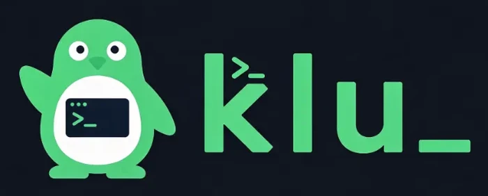
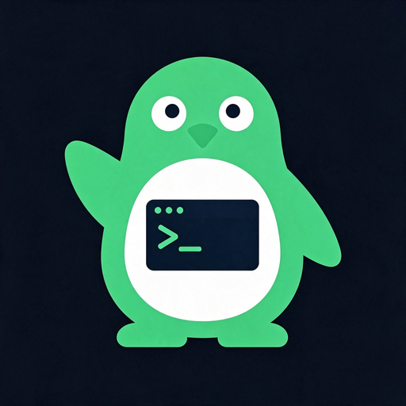

# KLU

<p align="center">
  
</p>

<p align="center">
  <strong>Tarayıcıda Linux terminali ve Git öğren.</strong><br />
  Kurulum gerektirmeyen, Türkçe ve etkileşimli bir eğitim simülatörü.
</p>

<p align="center">
  <a href="https://klu-shell.pages.dev/">Canlı uygulama</a> ·
  <a href="https://github.com/yavuzumut/klu-shell">GitHub deposu</a> ·
  <a href="ARCHITECTURE.md">Mimari</a>
</p>

<p align="center">
  
</p>

## KLU nedir?

KLU, Linux terminali ve Git kavramlarını tarayıcı içinde uygulayarak öğrenmeye yönelik bir simülatördür. Dersleri izleyebilir, komutları güvenli bir sanal dosya sisteminde deneyebilir ve ilerlemeni tarayıcıda saklayabilirsin.

> **Simülasyon sınırları:** KLU gerçek Bash veya gerçek bir Linux sistemi değildir. `git clone`, `git push` ve `git pull` GitHub’a ya da başka bir Git sunucusuna bağlanmaz; uzak depo işlemleri VirtualFS içindeki `/var/klu-remotes` alanında simüle edilir. Meraklısına bölümündeki araç kartları tanıtım içeriğidir; bu araçları KLU terminalinde çalıştırmaz.

**English summary:** KLU is a browser-based learning simulator for Linux terminal and Git concepts. It uses an in-memory virtual filesystem and simulated local remotes; it is not a real Bash shell and does not connect to GitHub for Git operations.

## Özellikler

### Linux terminal öğrenimi

- **VirtualFS:** Dosya ve dizinleri tarayıcı belleğinde tutan, Linux benzeri bir sanal dosya sistemi.
- **Shell:** Komutları, boru hatlarını, yönlendirmeleri ve temel kabuk operatörlerini simüle eden yorumlayıcı.
- **Seviye 0–3 dersleri:** Temel terminal alışkanlıklarından dosya işlemleri, arama ve süreç konularına uzanan Türkçe dersler ve görevler.
- **Serbest Mod:** Ders akışından bağımsız olarak sanal terminalde pratik alanı; canlı dosya ağacıyla birlikte çalışır.
- **Hile Kağıdı:** Komutları ve örnekleri hızlıca inceleyip terminale aktarabileceğin başvuru alanı.
- **Meraklısına:** Gerçek dünyadaki popüler Linux araçlarını ve kurulum örneklerini tanıtan rehber. Bu araçlar simülatör içinde çalıştırılmaz.
- **Temalar:** Koyu, açık ve farklı renk düzenleri; terminal görünümü temayla birlikte güncellenir.

### Git öğrenimi

- **Git 1–4 motoru:** Yerel depo başlatma, staging ve commit, diff/restore, branch/merge ve uzak depo akışları.
- **Etkileşimli Git dersleri:** Git kavramlarını motorun sanal depolarında adım adım uygular.
- **Yerel uzak depo simülasyonu:** Clone/push/pull, VirtualFS içindeki `/var/klu-remotes` alanını kullanır; gerçek internet bağlantısı veya GitHub hesabı gerektirmez.

## Başlangıç

Gereksinim: Node.js `>=22.12.0`.

```bash
git clone https://github.com/yavuzumut/klu-shell.git
cd klu-shell
npm ci
npm run dev
```

Vite geliştirme sunucusunun verdiği yerel adresi tarayıcıda aç.

## Geliştirme ve doğrulama

```bash
npx tsc --noEmit
npm test
npm run build
```

Test sayıları değişebileceğinden README’de sabitlenmiyor; `npm test` güncel toplamı terminalde gösterir. Build çıktısı `dist/` dizinine yazılır. Yerel üretim önizlemesi için `npm run preview` kullan.

## Katkı ve içerik geliştirme

- Linux dersleri `src/lessons/content/level0`–`level3` altında tutulur. İlgili seviye dizinindeki `index.ts` dosyasına yeni dersi kaydet ve doğrulama kapsamını `src/lessons/validator.test.ts` ile kontrol et.
- Git dersleri `src/git/lessons/` altında bulunur; motor ve doğrulama akışları `src/core/git/` ile birlikte çalışır.
- Shell komutları `src/core/commands/`, kabuk yorumlayıcısı `src/core/shell/`, VirtualFS `src/core/fs/` altındadır.
- Ayrıntılı katman ve veri akışı için [ARCHITECTURE.md](ARCHITECTURE.md) belgesine bak.

## Teknoloji

React, TypeScript, Vite, xterm.js, Marked, DOMPurify ve Vitest. Sürümler ve komutlar için `package.json` kaynak kabul edilir.

## Lisans

MIT. Ayrıntılar için [LICENSE](LICENSE) dosyasına bak.
